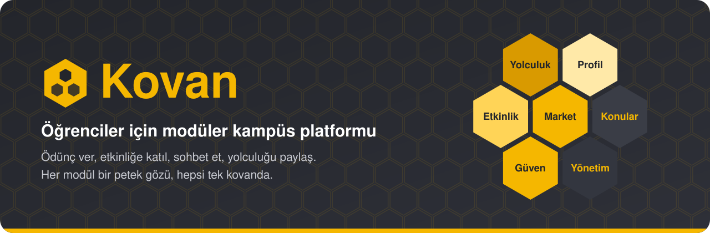
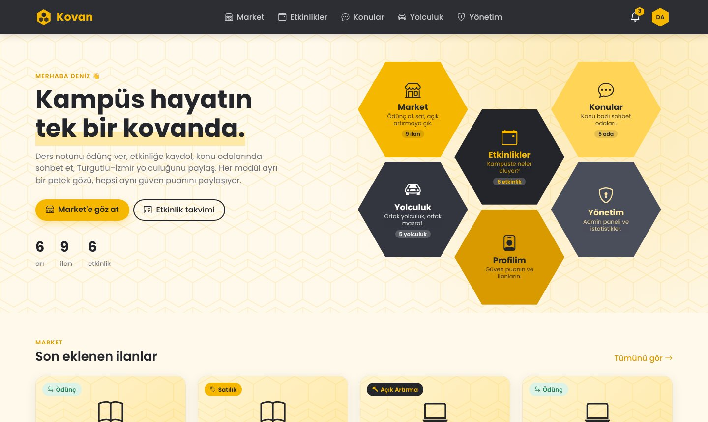
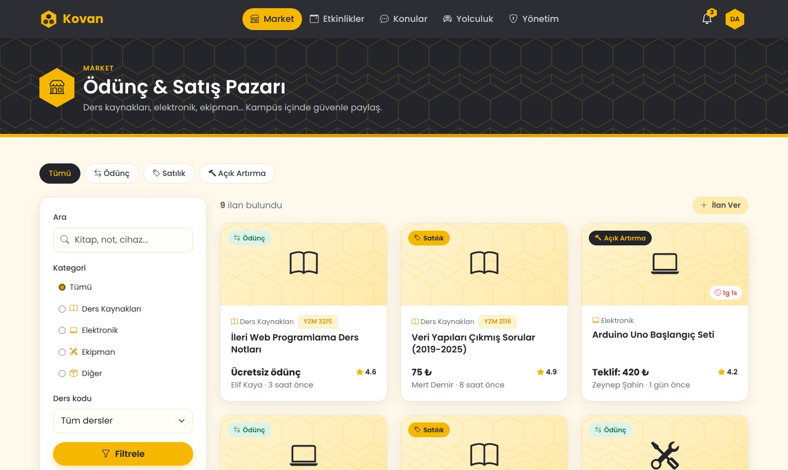
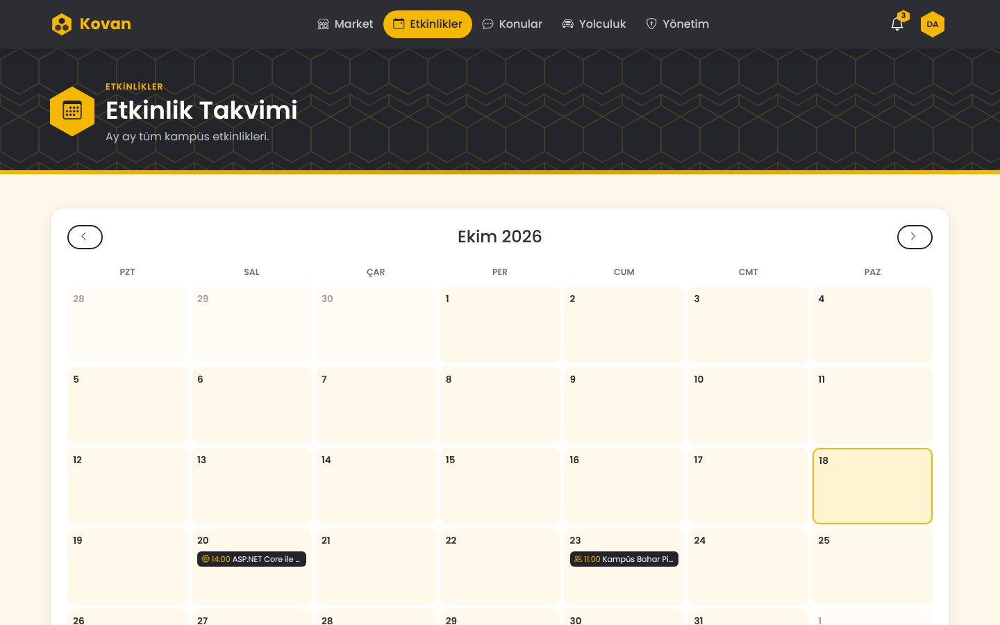
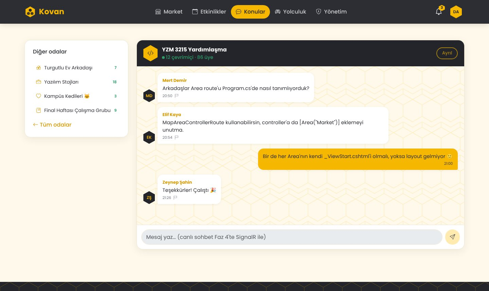
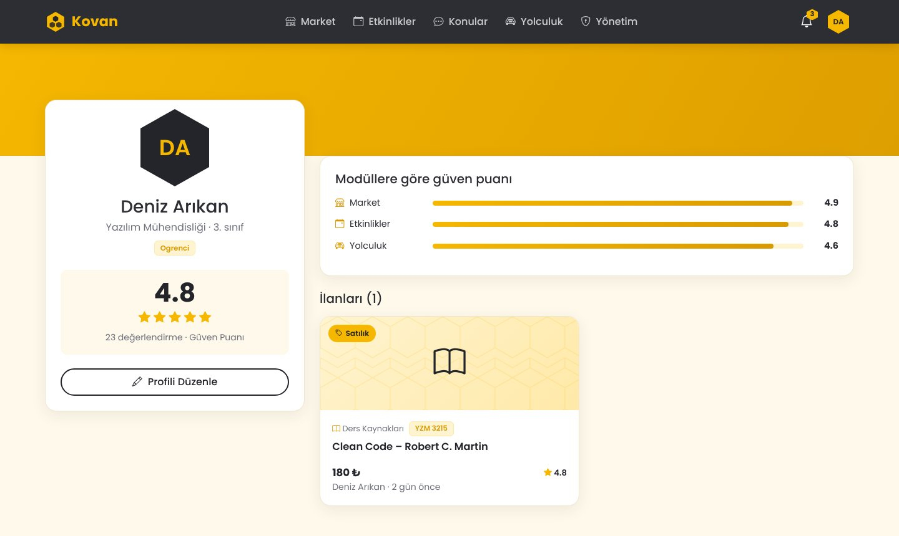
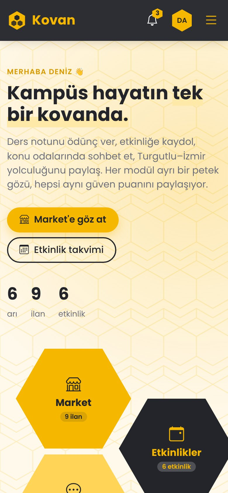
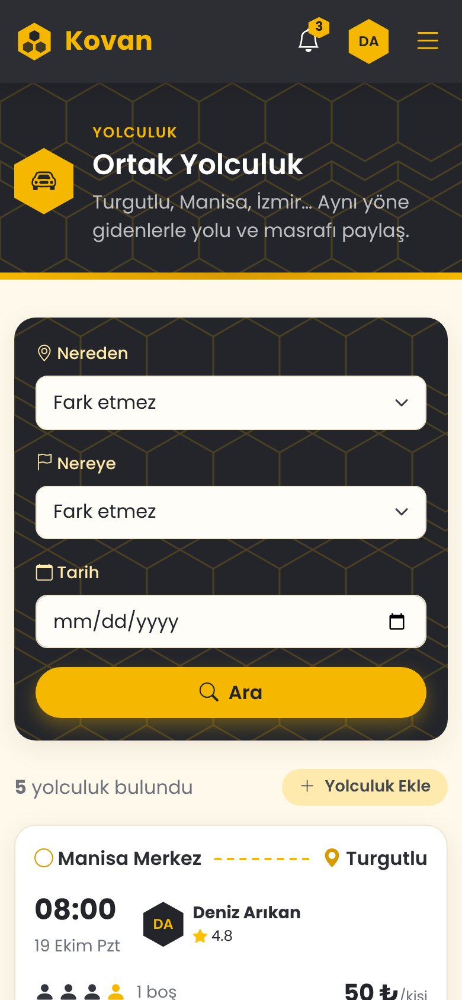
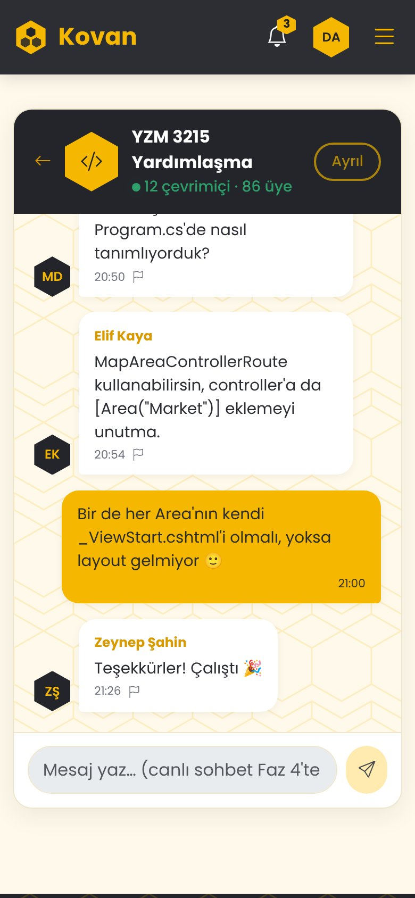

<div align="center">



<p>
  
  
  
  
  
  
  
</p>

**YZM 3215 İleri Web Programlama** · Manisa Celal Bayar Üniversitesi · Yazılım Mühendisliği

</div>

Kovan, kampüs hayatındaki küçük ama sürekli ihtiyaçları tek bir yerde toplar. Ders notunu ödünç verirsin, kulübün etkinliğine kaydolursun, ders odasında soru sorarsın, hafta sonu İzmir'e gidecek birini bulursun. Her modül ayrı bir **petek gözü** gibi kendi işini yapar; ama hepsi aynı kullanıcı, bildirim ve **güven puanı** altyapısını paylaşır. Bir modülde güvenilir olan öğrenci, diğerlerinde de öyle görünür.

## Ekran görüntüleri

<p align="center">
  
</p>

<p align="center">
  
  
</p>

<p align="center">
  
  
</p>

<p align="center">
  
  
  
</p>

<p align="center"><sub>Ana sayfa · Market · Etkinlik takvimi · Sohbet odası · Profil · Mobil görünümler. Görüntüler örnek verilerle çekildi.</sub></p>

## Modüller

| | Modül | Ne yapar? |
|:-:|---|---|
| 🛒 | **Market** | Eşya ödünç verme, satış ve açık artırma. Ders kaynaklarında ders koduna göre arama (ör. YZM 3215). |
| 📅 | **Etkinlikler** | Kulüp ve bireysel etkinlikler, kontenjan ve bekleme listesi, aylık takvim. |
| 💬 | **Konular** | "Turgutlu Ev Arkadaşı", "Yazılım Stajları" gibi konu bazlı sohbet odaları. |
| 🚗 | **Yolculuk** | Turgutlu, Manisa, İzmir arası ortak yolculuk ve koltuk rezervasyonu. |
| 🛡️ | **Yönetim** | Kullanıcı ve içerik yönetimi, şikâyetler, istatistikler. |

**Ortak altyapı:** profil, güven puanı, navbar'da bildirim zili, şikâyet sistemi.

## Çalıştırma

[.NET 8 SDK](https://dotnet.microsoft.com/download/dotnet/8.0) kurulu olmalı.

```bash
git clone https://github.com/highlvmami/Kovan.git
cd Kovan
dotnet run --project Kovan
```

Tarayıcıda **http://localhost:5080** adresini aç. Visual Studio kullanıyorsan `Kovan.sln` dosyasını açıp **F5**'e basman yeterli.

Bilgisayarında sadece .NET 10 varsa (PowerShell):

```powershell
$env:DOTNET_ROLL_FORWARD="Major"; dotnet run --project Kovan
```

> Veriler şimdilik bellekte tutulur. Uygulama yeniden başlayınca formdan eklenen ilanlar ve profil değişiklikleri silinir (Faz 2'de veritabanı geliyor).

## Proje yapısı

Her modül ayrı bir **Area**. Yeni bir modül eklemek için `Areas` altına yeni bir klasör açmak yeterli.

```
Kovan/
├── Areas/            Market, Events, Topics, Carpool, Admin
│   └── Market/
│       ├── Controllers/
│       ├── Models/       (ViewModel'ler)
│       └── Views/
├── Controllers/      Ana sayfa, Giriş/Kayıt, Profil
├── Views/            Genel sayfalar ve ortak _Layout
├── Core/             Entity'ler, servis arayüzleri ve servisler
├── Data/             Örnek veri (Faz 2'de veritabanı)
├── Hubs/             SignalR (Faz 4)
├── ViewComponents/   Bildirim zili, Kampüste yeni ilanlar
└── wwwroot/          CSS (her modülün kendi dosyası), JS, görseller
```

## Yol haritası

- [x] **Faz 1 · İskelet:** Area yapısı, tema, 8 controller ve 18 sayfa, örnek veri servisleri
- [x] **Sunum 2:** HtmlHelpers ile İlan Ver ve Profili Düzenle formları, `LatestListings` ViewComponent'i ([ayrıntılar](docs/SUNUM-2.md))
- [ ] **Faz 2 · Veritabanı:** EF Core + SQLite, migration, seed data, Identity ile giriş
- [ ] **Faz 3 · İşlevler:** ilan, etkinlik ve yolculuk ekleme/düzenleme, iş kuralları
- [ ] **Faz 4 · Canlı:** SignalR ile sohbet, canlı teklif ve bildirim, artırmayı kapatan arka plan görevi
- [ ] **Faz 5 · Son dokunuşlar:** admin paneli, güven puanı, şikâyet ve moderasyon

## Nasıl çalışır?

- **İnce controller'lar:** Controller sadece servisten veriyi alır, ViewModel'e koyar ve sayfaya verir. İş mantığı `Core/Services` içinde.
- **Arayüz arkasında servisler:** Servisler Dependency Injection ile gelir. Şu an örnek veriyle çalışıyorlar; Faz 2'de veritabanı servisleriyle değiştirilecekler ve sayfalara hiç dokunulmayacak.
- **ViewModel:** Sayfalara veritabanı nesneleri değil, sayfaya özel ViewModel'ler gider.
- **Tekrar kullanılan parçalar:** İlan kartı, etkinlik kartı, sayfa başlığı ve boş durum partial; bildirim zili ve "Kampüste yeni ilanlar" ViewComponent olarak yazıldı. Kullanıldıkları yerler kodda `[PARTIAL VIEW]` ve `[VIEW COMPONENT]` yorumlarıyla işaretli.
- **HtmlHelpers ile formlar:** Market → İlan Ver (`/Market/Listings/Create`) ve Profili Düzenle formları `Html.TextBoxFor`, `Html.DropDownListFor` gibi HtmlHelper'larla yazıldı. Girilen ilan ana sayfada, Market'te, profilde, yan sütundaki ViewComponent'te ve bildirim zilinde görünür.
- **Tasarım:** Bal sarısı, antrasit ve krem renkler, petek motifleri, Poppins fontu. Tüm sayfalar telefonda, tablette ve masaüstünde düzgün görünür.
